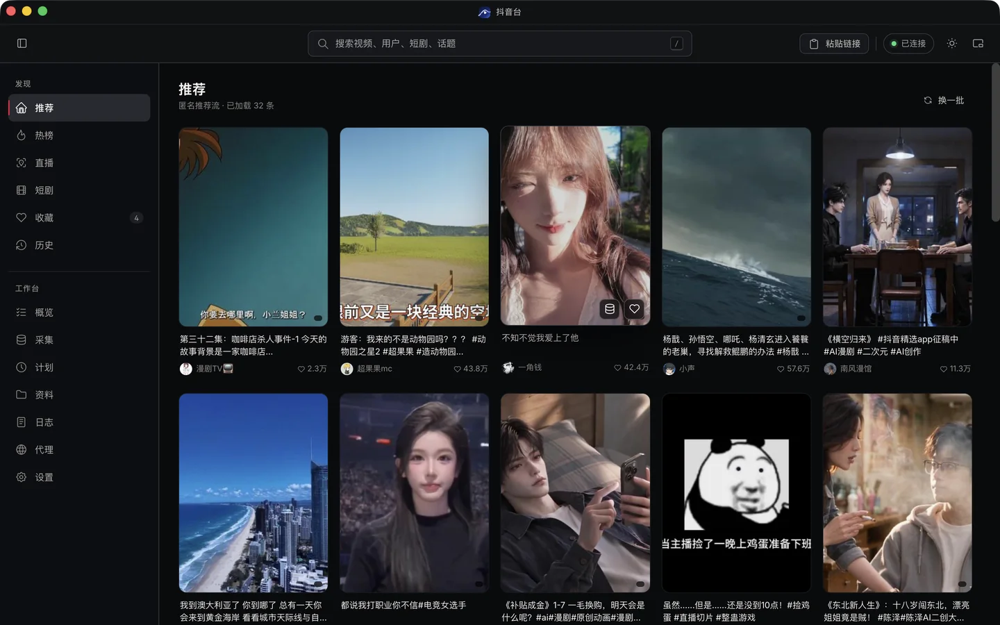

English | [简体中文](README.md)

# DouyinTai

Status: current
Summary: user entry point for positioning, features, differences, install, privacy and build.

[](https://github.com/firethief6/douyintai/actions/workflows/package.yml)

> Unofficial third-party desktop client, not affiliated with Douyin or ByteDance. Interfaces and signing resources come from the Douyin client and can change upstream.

A desktop workbench for Douyin. Discovering, watching, downloading, collecting, live recording and local archiving happen in one window. A Tauri 2 shell with a native TypeScript view layer; HTTP, envelope signing, identity pool and business endpoints are all implemented in-process in Rust.

Current version **0.1.0, early preview**.



## Features

- Discover: recommended feed, hot list, search, topics, user pages, short-drama wall and autoplay
- Watch: player page, speed, fullscreen, next/previous, comments and replies, danmaku, live playback and chat
- Live recording: HLS segments on disk with an m3u8 index, auto-record on stream start, stop on duration or free space
- Download: single item, batch, multi-link paste, txt/csv import, quality tier, original audio, cover, concurrent queue, pause and resume
- Collect: full-field JSONL, batch collection, scheduled jobs, comment export
- Library: favorites, history, downloaded, open folder, recycle bin, export
- Network: on-device anonymous identities, pool refill, own egress proxy, CDN direct toggle
- Desktop shell: tray, mini window, global show/hide, window memory, light and dark themes, command palette, collapsible sidebar
- Diagnostics: adjustable log level, error and network records, redacted diagnostic bundle

The library relocates files by author, title and date. It is not the download directory.

## How it differs

Douyin tooling splits into three groups: self-hosted APIs, downloaders and single-purpose tools.

1. Self-hosted APIs, represented by [Douyin_TikTok_Download_API](https://github.com/Evil0ctal/Douyin_TikTok_Download_API), ship a full interface, console, MCP and collection pipeline at the cost of Docker, Postgres, Redis and an optional Chromium service.
2. Downloaders include the Python [TikTokDownloader](https://github.com/JoeanAmier/TikTokDownloader) and [douyin-downloader](https://github.com/jiji262/douyin-downloader), plus Tauri GUIs and resource sniffers such as [res-downloader](https://github.com/putyy/res-downloader).
3. Single-purpose tools include the live-only [DouyinLiveRecorder](https://github.com/ihmily/DouyinLiveRecorder) and the faster-browsing [douyin-desktop-v2](https://github.com/yhgeo/douyin-desktop-v2).

The table compares directly overlapping paths only. `✓` means the product ships that path, not that the implementation is good.

| Project (stars) | Form | Install cost | Discover/watch | Download/collect | Live record | Local library | Platform and account |
|---|---|---|---|---|---|---|---|
| Douyin_TikTok_Download_API (21.3k) | self-hosted API | Docker, Postgres, Redis, Chromium | console | ✓ | — | — | any server; self-built or minted identity |
| TikTokDownloader (17.4k) | Python CLI/WebUI | Python 3.12 | — | ✓ | — | export directory | cross-platform; login optional |
| douyin-downloader (12.6k) | Python CLI + closed desktop | Python; desktop tier needs activation | — | ✓ | — | archive directory | cross-platform; login optional |
| putyy/res-downloader (21.2k) | resource sniffer | install a certificate, enable proxy | — | ✓ | — | download directory | cross-platform; packet capture |
| DouyinLiveRecorder (11.2k) | live recorder | Python, FFmpeg | — | — | ✓ | recorded files | 40+ platforms; login optional |
| douyin-desktop-v2 | native player | place mpv by hand | ✓ | — | — | — | Windows; anonymous |
| DouyinTai | desktop workbench | one installer, no runtime | ✓ | ✓ | ✓ | ✓ | Linux and macOS arm64 verified; Windows preview; no login |

Star counts read on 2026-11-10 and only indicate sample size.

Fits:

- Daily desktop scanning, judging and archiving of material.
- Holding a link list or author page and needing queued runs with visible failures.
- No account login and no server to maintain.

Does not fit:

- TikTok, Bilibili or YouTube.
- Occasional single-video downloads.
- MCP, offline transcription, multi-user or cluster scheduling.
- Account collections and the following feed.

## Platform status

| Platform | Status |
|---|---|
| Linux x86_64 | verified, self-build |
| macOS arm64 | verified |
| Windows x86_64 | installer start and H.264/HEVC playback verified, still preview |

## Install

The Windows 0.1.0 installer is a ~22.8 MB MSI. It needs no Python, Node, Java, ffmpeg, Docker, Postgres, Redis or resident browser.

Installers are not developer-signed. On first macOS start run:

```bash
xattr -dr com.apple.quarantine /Applications/抖音台.app
```

On Windows click "More info → Run anyway" in SmartScreen. The installer downloads and installs WebView2 when missing; HEVC playback needs the system codec extension, see [Windows media](docs/WINDOWS-MEDIA.md).

Usage after install: [guide](docs/USAGE.md). Dependencies and artifacts per platform: [build](docs/BUILD.md).

## Data and privacy

- No Douyin password is stored.
- An anonymous device identity is generated on first run, refilled dynamically, and kept on the machine only.
- Identities are rented by health and replaced once invalid, retired or over quota; a new identity usually needs 1–2 days to clear the platform's new-device risk window.
- Settings, library, tasks and schedules live in a local SQLite file.
- Downloads and logs write to local directories only.
- The app talks to Douyin endpoints directly and no project server sits in between.
- The egress proxy is off by default and only takes over Douyin endpoints; CDN traffic stays direct.
- Paid and integrated short dramas still return a play address and content key while anonymous; CENC decryption runs in a local loopback proxy and keys are not persisted.

## Known limits

- Only Douyin.
- Early preview with unsigned installers.
- Account collections and the following feed are unavailable.
- Anonymous identities hit rate limits; some topic searches ask for login or a retry once quota is spent.
- A new identity can meet empty live rooms or failing comments during the risk window.
- Scheduled jobs only take new works plus auto-record; nothing keeps recording in the background after shutdown, and only still-live schedules are caught up on restart.
- Encrypted downloads stay encrypted bytes; playing outside the app needs the later decrypt step.
- V2 playback credentials are not wired.
- Interfaces and signing resources can break upstream at short notice.
- HEVC preview needs the system decoder.

## Build

Prerequisites: Rust stable, Node.js 20+, pnpm 10+, platform WebView dependencies.

```bash
pnpm install --frozen-lockfile
pnpm check
pnpm tauri build
```

## Contributing

Read [CONTRIBUTING.md](CONTRIBUTING.md) before submitting. Report security issues privately per [SECURITY.md](SECURITY.md).

## License

Project code is Apache-2.0. Bundled third-party resources are listed in [THIRD_PARTY_NOTICES.md](THIRD_PARTY_NOTICES.md).

Douyin names, interfaces and bundled signing resources belong to their respective owners.
