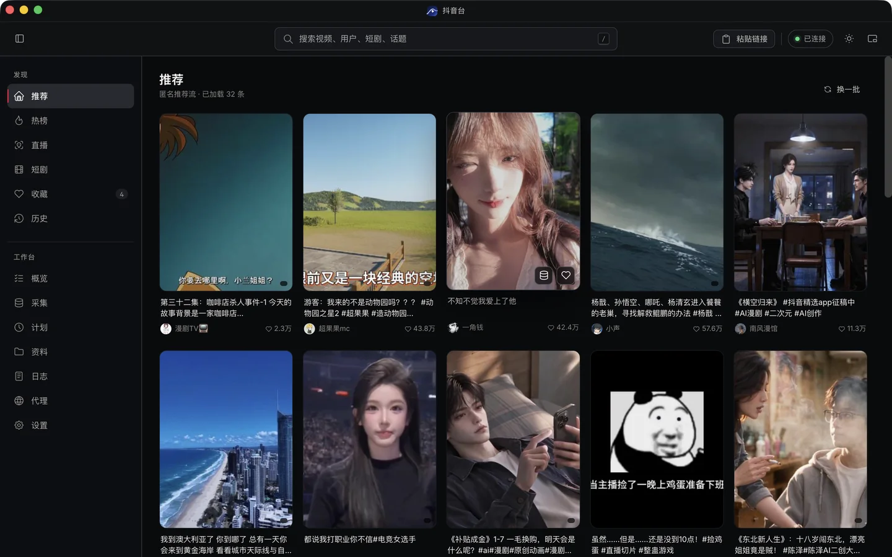

# 抖音台（douyintai）

[English](README.en.md) | 简体中文

状态：现行
摘要：用户入口，汇总定位、功能、差异、安装、隐私和构建。

[](https://github.com/firethief6/douyintai/actions/workflows/package.yml)

> 非官方第三方桌面客户端，与抖音、字节跳动无隶属关系。接口和签名资源来自抖音客户端，可能随上游变化。

抖音桌面工作台。发现、观看、下载、采集、直播录制和本地留档在同一个窗口完成。Tauri 2 与原生 TypeScript 提供桌面壳和视图层；HTTP、信封签名、身份池和业务接口全部在进程内用 Rust 实现。

当前版本 **0.1.0，early preview**。



## 功能

- 发现：推荐流、热搜榜、搜索、话题、用户主页、短剧墙与连播
- 观看：播放页、倍速、全屏、上下条、评论与二级回复、弹幕、直播播放与聊天
- 直播录制：HLS 分片落盘与 m3u8 索引，支持开播自动录制、按时长和剩余磁盘停止
- 下载：单条、批量、多链接粘贴、txt/csv 导入、画质档位、原声、封面、并发队列、暂停与续传
- 采集：全字段 JSONL、批量采集、定时计划、评论导出
- 资料库：收藏、历史、已下载、打开目录、回收站、导出
- 网络：本机生成匿名身份、动态补池、自备出口代理、CDN 直连开关
- 桌面壳：托盘、迷你窗、全局显示隐藏、窗口记忆、深浅主题、命令面板、可折叠侧栏
- 诊断：可调日志级别、错误与网络记录、自动脱敏的诊断包导出

资料库可以按作者、标题和日期重新定位文件，不等同于下载目录。

## 和同类工具的差异

抖音工具主要有三类：自托管 API、下载器和单场景工具。

1. 自托管 API 以 [Douyin_TikTok_Download_API](https://github.com/Evil0ctal/Douyin_TikTok_Download_API) 为代表，接口、控制台、MCP 和采集流水线完整，代价是 Docker、Postgres、Redis 和可选的 Chromium 服务。
2. 下载器包括 Python 的 [TikTokDownloader](https://github.com/JoeanAmier/TikTokDownloader)、[douyin-downloader](https://github.com/jiji262/douyin-downloader)，也包括 Tauri GUI 和 [res-downloader](https://github.com/putyy/res-downloader) 一类资源嗅探器。
3. 单场景工具包括只处理直播的 [DouyinLiveRecorder](https://github.com/ihmily/DouyinLiveRecorder) 和只改善浏览速度的 [douyin-desktop-v2](https://github.com/yhgeo/douyin-desktop-v2)。

下表只比较直接覆盖的路径。`✓` 表示产品内置该路径，不表示实现质量。

| 项目（star 数） | 形态 | 安装门槛 | 发现/观看 | 下载/采集 | 直播录制 | 本机资料库 | 平台与账号 |
|---|---|---|---|---|---|---|---|
| Douyin_TikTok_Download_API（21.3k） | 自托管 API | Docker、Postgres、Redis、Chromium | 控制台 | ✓ | — | — | 任意服务器；需自建或匿名铸造 |
| TikTokDownloader（17.4k） | Python CLI/WebUI | Python 3.12 | — | ✓ | — | 导出目录 | 跨平台；可登录 |
| douyin-downloader（12.6k） | Python CLI + 闭源桌面 | Python；桌面高级功能需激活 | — | ✓ | — | 归档目录 | 跨平台；可登录 |
| putyy/res-downloader（21.2k） | 资源嗅探器 | 安装证书、开代理 | — | ✓ | — | 下载目录 | 跨平台；抓包 |
| DouyinLiveRecorder（11.2k） | 直播录制 | Python、FFmpeg | — | — | ✓ | 录制文件 | 40+ 平台；可登录 |
| douyin-desktop-v2 | 原生播放器 | 手动放置 mpv | ✓ | — | — | — | Windows；匿名 |
| 抖音台 | 桌面工作台 | 单个安装包，无运行时 | ✓ | ✓ | ✓ | ✓ | Linux 和 macOS arm64 已验证；Windows 预览；免登录 |

star 数据取自 2026-11-10，只表示样本规模。

适合：

- 每天在桌面扫描素材、判断和留档。
- 持有链接表或作者页，需要排队执行并查看失败。
- 不登录账号，不维护服务器。

不适合：

- 需要 TikTok、B 站或 YouTube。
- 只偶尔下载单条视频。
- 需要 MCP、离线转写、多用户或集群调度。
- 需要账号收藏夹和关注流。

## 平台状态

| 平台 | 状态 |
|---|---|
| Linux x86_64 | 已验证，可自行构建 |
| macOS arm64 | 已验证 |
| Windows x86_64 | 安装包启动及 H.264/HEVC 播放已验证，继续预览 |

## 安装

Windows 0.1.0 安装包是约 22.8 MB 的 MSI。安装不需要 Python、Node、Java、ffmpeg、Docker、Postgres、Redis 或常驻浏览器。

安装包不做开发者签名。macOS 首次启动执行：

```bash
xattr -dr com.apple.quarantine /Applications/抖音台.app
```

Windows 在 SmartScreen 中点击“更多信息 → 仍要运行”。缺少 WebView2 时安装程序会下载并安装；播放 HEVC 高清档需要系统解码扩展，见 [Windows 播放组件](docs/WINDOWS-MEDIA.md)。

安装后操作见 [使用指南](docs/USAGE.md)。各平台依赖和产物位置见 [构建](docs/BUILD.md)。

## 数据与隐私

- 不保存抖音账号密码。
- 首次运行时在本机生成匿名设备身份，动态补池，只保存在本机。
- 身份按健康度租用，失效、退役或达到上限后自动替换；新身份通常需要 1–2 天度过平台新设备风控期。
- 设置、资料库、任务和计划存本机 SQLite。
- 下载和日志只写本机目录。
- 应用直接连接抖音接口，不经过项目自建服务器。
- 出口代理默认关闭，只接管抖音接口，CDN 默认直连。
- 平台标记为付费且已接入的短剧，匿名状态可取到播放地址和内容密钥，在本机回环代理内完成 CENC 解密，密钥不落盘。

## 已知限制

- 不做 MCP、离线转写、多用户和集群调度。
- 定时计划只有追作者新作品和开播自动录制；应用关闭时不在后台录制，启动后只补探仍在播的计划。
- 账号收藏夹和关注流不可用；资料库收藏为本地收藏。
- 匿名身份会遇到限流，部分话题搜索在额度耗尽时提示登录或重试。
- 新身份在风控期内可能遇到直播空包或评论失败。
- 加密集下载后仍为原始加密字节，离开应用播放需要后续下载侧解密。
- V2 播放凭证未接入。
- 接口和签名资源可能随上游变化，短期失效。
- HEVC 预览依赖系统解码器。

## 构建

前置：Rust stable、Node.js 20+、pnpm 10+、平台 WebView 依赖。

```bash
pnpm install --frozen-lockfile
pnpm check
pnpm tauri build
```

## 参与

提交前阅读 [CONTRIBUTING.md](CONTRIBUTING.md)。安全问题按 [SECURITY.md](SECURITY.md) 私密报告。

## 许可证

项目代码使用 [Apache-2.0](LICENSE)。随包第三方资源见 [THIRD_PARTY_NOTICES.md](THIRD_PARTY_NOTICES.md)。

抖音名称、接口和随包签名资源的权利归各自权利人所有。
